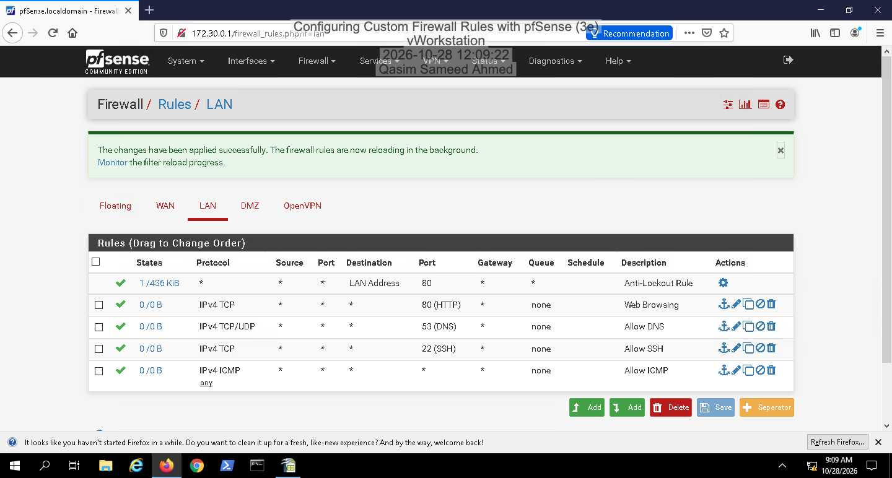
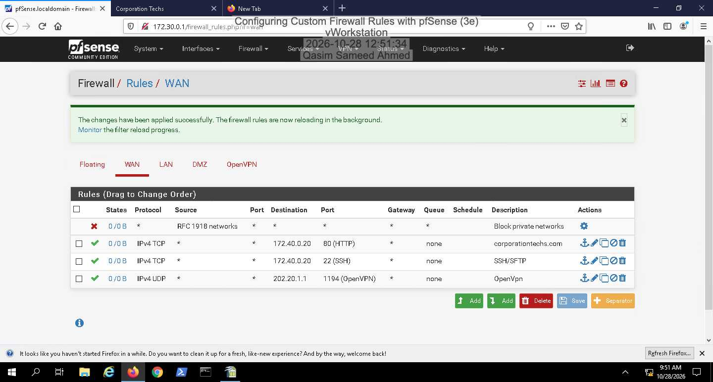
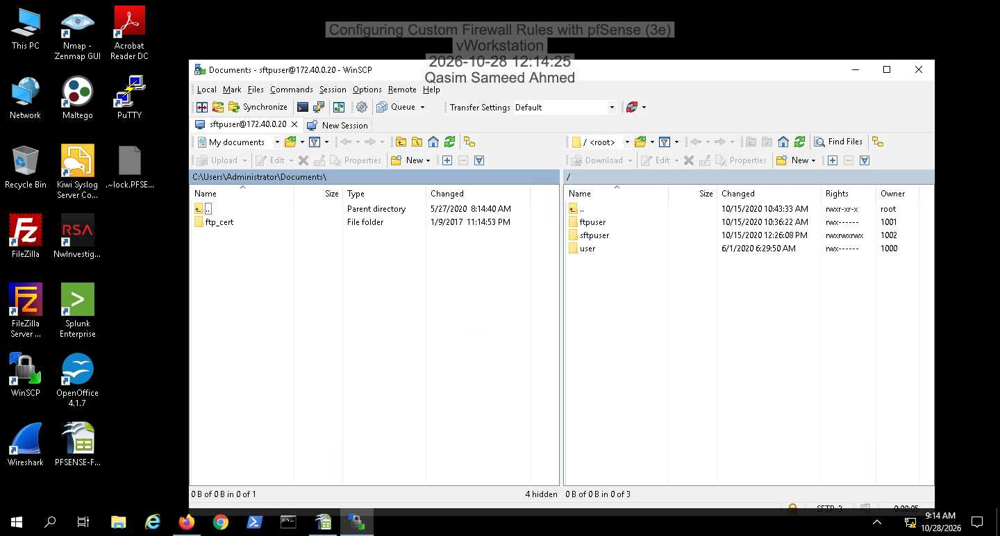
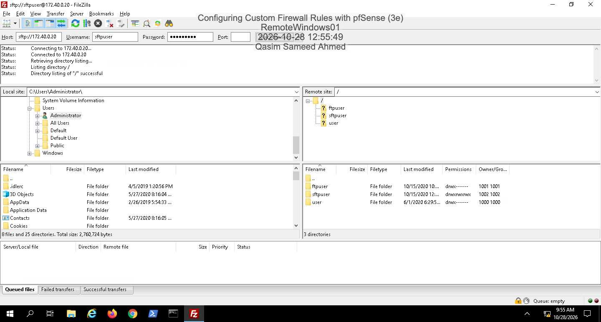
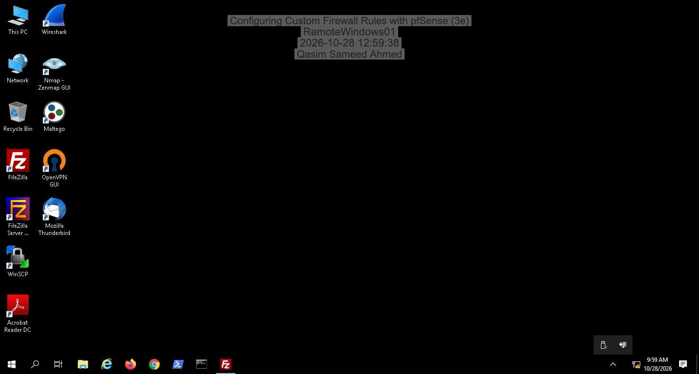
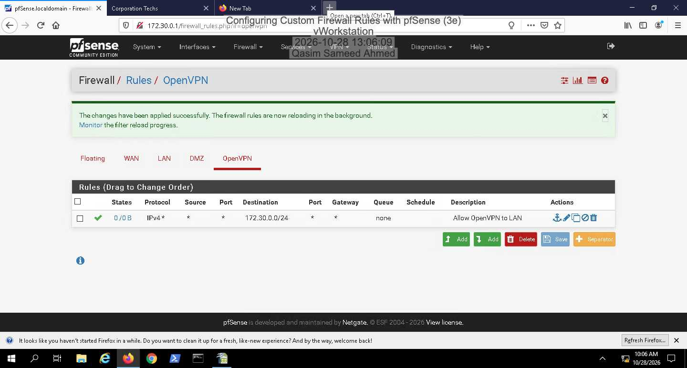
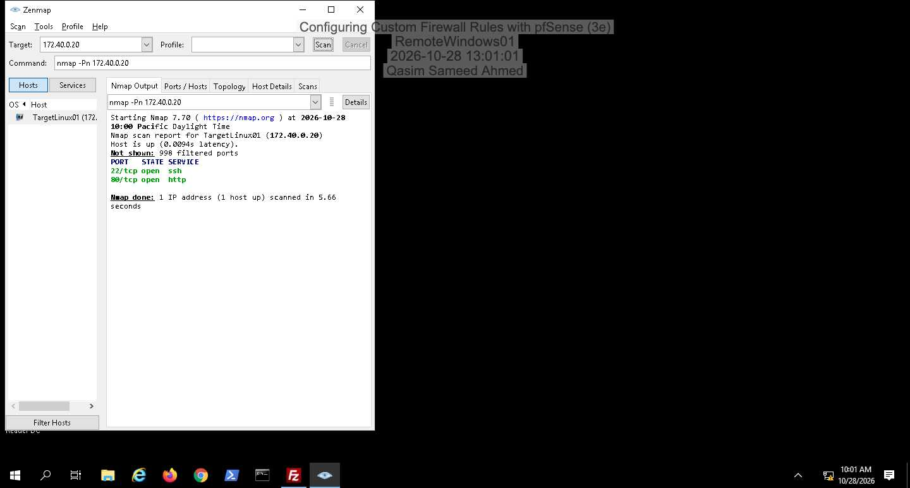
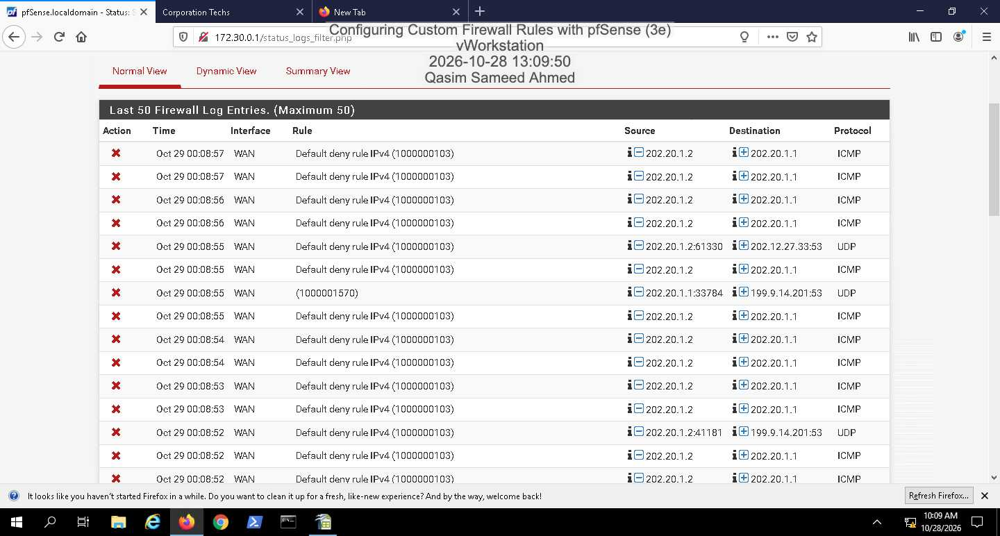
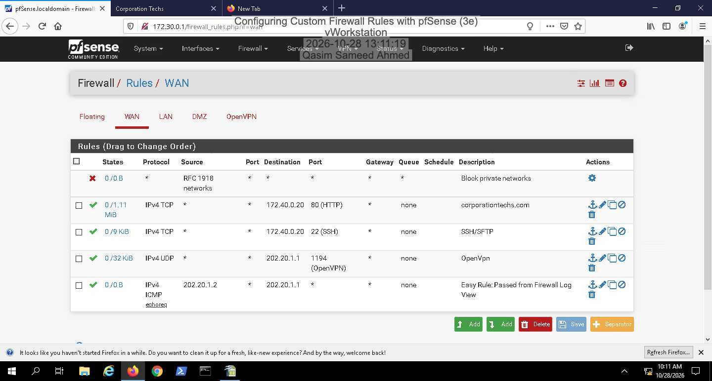

# Configuring Custom Firewall Rules with pfSense

Hands-on cybersecurity lab focused on planning, configuring, and validating firewall rules in pfSense.

## Objectives

- Plan restrictive LAN firewall rules
- Configure outbound access for HTTP, DNS, SSH/SFTP, and ICMP
- Configure inbound WAN access for HTTP, SSH/SFTP, and OpenVPN
- Validate firewall behavior using connectivity tests, SFTP, OpenVPN, and Nmap
- Use pfSense EasyRule to permit a specific ICMP request

## Lab Environment

- pfSense firewall/router
- Windows Server workstations
- Ubuntu Linux DMZ host
- WinSCP and FileZilla
- OpenVPN GUI
- Nmap/Zenmap

## Firewall Configuration

### LAN Rules

| Protocol | Port | Purpose |
|---|---:|---|
| TCP | 80 | Web browsing |
| TCP/UDP | 53 | DNS resolution |
| TCP | 22 | SSH/SFTP |
| ICMP | N/A | Network diagnostics |

### WAN Rules

| Protocol | Destination | Port | Purpose |
|---|---|---:|---|
| TCP | DMZ web server | 80 | HTTP access |
| TCP | DMZ Linux host | 22 | SFTP/SSH access |
| UDP | pfSense WAN address | 1194 | OpenVPN access |
| ICMP | pfSense WAN address | N/A | EasyRule troubleshooting exception |

## Verification Results

- DNS and ICMP connectivity verified from the LAN
- Corporate website accessed successfully over HTTP
- SFTP access verified to the DMZ Linux host
- OpenVPN connection established successfully
- Nmap identified only the intended public services: TCP 22 and TCP 80
- VPN users successfully reached the internal LAN mail service
- A blocked ICMP request was identified in the firewall log and permitted with EasyRule

## Evidence

### Firewall configuration

### Secure remote access

### Network validation and troubleshooting

## What I Learned

- Firewall rules are evaluated on the interface where traffic enters, so the correct interface must be selected for each policy.
- A restrictive default-deny model improves security by allowing only required services.
- Stateful firewalls track permitted conversations, reducing the need for separate return-traffic rules.
- DMZ services should be exposed individually instead of granting broad access to internal networks.
- VPN connectivity requires both a working tunnel and an interface rule that permits access to the needed internal network.
- Nmap helps verify that the externally visible attack surface matches the intended firewall configuration.
- Firewall logs and EasyRule provide a practical workflow for investigating blocked traffic and adding narrowly scoped exceptions.

## Skills Demonstrated

`pfSense` `Firewall Administration` `ACL Design` `Network Segmentation` `DMZ Security` `OpenVPN` `SFTP` `Nmap` `Firewall Log Analysis` `Network Troubleshooting`

## Disclaimer

All testing was completed in the provided isolated lab environment.

## Skills Demonstrated

`pfSense` `Firewall Rules` `Network Security` `Stateful Firewalling` `ACL Design` `WAN/LAN Segmentation` `DMZ` `OpenVPN` `SFTP` `Nmap` `Firewall Log Analysis`
